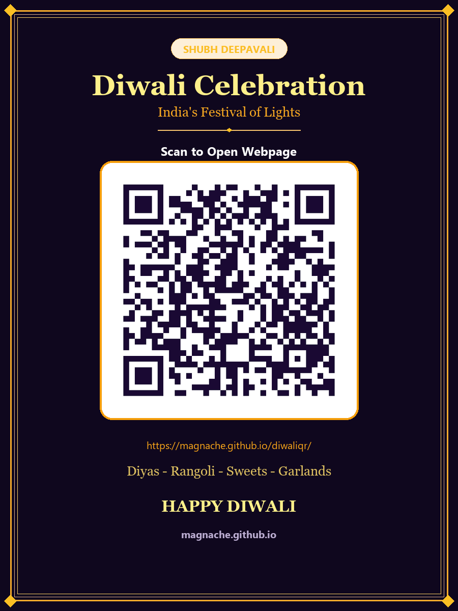

# 🪔 Diwali - India's Festival of Lights

> An interactive celebration webpage built from the **Diwali (1).docx** document, celebrating the triumph of light over darkness, hope, wisdom, and festive togetherness.

[](https://magnache.github.io/diwaliqr/)
[](https://magnache.github.io/diwaliqr/)

---

## 📱 Scan QR Code to Open Webpage

Scan this QR code with any smartphone camera (iPhone, Android Google Lens, or WhatsApp scanner) to open the live Diwali celebration page:

<p align="center">
  
</p>

- **Live URL**: [https://magnache.github.io/diwaliqr/](https://magnache.github.io/diwaliqr/)
- **Standalone QR Image**: [`assets/images/qrcode.png`](assets/images/qrcode.png)
- **High-Resolution Festive Card (900×1200)**: [`assets/images/diwali_qr_card.png`](assets/images/diwali_qr_card.png)

---

## ✨ Features & Document Sections

This webpage faithfully translates every section and detail from **Diwali (1).docx** into a luxurious, responsive experience:

1. **Hero Showcase**:
   - Original document photograph of the family lighting traditional diyas together.
   - Sacred Sanskrit shloka (*Tamaso Mā Jyotir Gamaya*).
   - Interactive sacred diya flame with sparkler animations.
2. **Overview of Diwali**:
   - The heritage of Deepavali as one of India's most cherished Hindu festivals.
   - Highlighting the victory of light over darkness and good over evil.
3. **The Symbolism of Light Over Darkness**:
   - Removing negativity and ignorance, filling lives with hope and wisdom.
   - Interactive **Darkness-to-Light Illumination Slider** revealing inner peace, compassion, kindness, and humility.
4. **Core Symbols of Diwali**:
   - Diyas, Rangoli, Sweets, and Garlands.
5. **The Four Pillars in Detail**:
   - 🪔 **Diyas (Oil Lamps)**: Spreading warmth and positivity; click to kindle.
   - 🎨 **Rangoli**: Auspicious threshold artwork welcoming guests and deities; click to shimmer colors.
   - 🌸 **Flowers & Garlands**: Sacred puja decor radiating fragrance and freshness.
   - 🍬 **Sweets (Mithai)**: Sharing joy, friendship, and sweetness among loved ones.
6. **Grand Finale & Wishes**:
   - **HAPPY DIWALI** grand greeting.
   - Interactive fireworks canvas: Click anywhere or tap to burst colorful fireworks.
   - Web Audio festive chimes (Mohanam/Bhupali raag scale).
   - Personalized Diwali greeting card generator with WhatsApp and clipboard sharing.

---

## 🚀 How to Deploy to GitHub Pages (GitHub ID: `magnache`)

The project is already initialized with a local git repository configured for `magnache/diwaliqr`.

### Option A: Create Repository on GitHub & Push (Recommended)

1. Open GitHub and create a new repository named **`diwaliqr`**:
   - URL: [https://github.com/new](https://github.com/new)
   - Repository Name: `diwaliqr`
   - Set to **Public**
   - Do **NOT** initialize with README (the repository already has everything configured)

2. In your terminal / command prompt, run:
   ```bash
   git add .
   git commit -m "Initial commit: Diwali celebration webpage, QR code, and assets"
   git push -u origin main
   ```

3. Enable GitHub Pages in your repository settings:
   - Go to: **Settings** → **Pages** (`https://github.com/magnache/diwaliqr/settings/pages`)
   - Under **Build and deployment**:
     - **Source**: Select `Deploy from a branch` (Branch: `main`, Folder: `/ (root)`)
     - OR select `GitHub Actions` (the repository includes `.github/workflows/deploy.yml` which will automatically deploy on every push!)
   - Click **Save**.

4. Your site will be live at:
   👉 **`https://magnache.github.io/diwaliqr/`**

---

## 📂 Project Structure

```text
diwaliqr/
├── index.html                     # Main semantic HTML5 webpage
├── style.css                      # Luxury festive stylesheet with glassmorphism
├── app.js                         # Particles, fireworks, audio engine & interactive logic
├── .nojekyll                      # Disables Jekyll processing on GitHub Pages
├── README.md                      # Documentation & deployment guide
├── qrcode.png                     # High-resolution QR code
├── diwali_qr_card.png             # Branded Diwali greeting card with QR code
├── Diwali (1).docx                # Original source document
├── assets/
│   └── images/
│       ├── diwali-family.png      # Original family photograph from Word document
│       ├── diya.jpg               # Brass diya oil lamp with marigolds
│       ├── rangoli.jpg            # Vibrant colorful rangoli mandala
│       ├── sweets.jpg             # Traditional Diwali sweets assortment
│       ├── qrcode.png             # Standalone QR code
│       └── diwali_qr_card.png     # Festive greeting card with QR code
└── .github/
    └── workflows/
        └── deploy.yml             # GitHub Actions automated Pages deployment workflow
```

---

<p align="center">
  <strong>Happy Deepavali • May Light Always Triumph Over Darkness ✨</strong>
</p>
